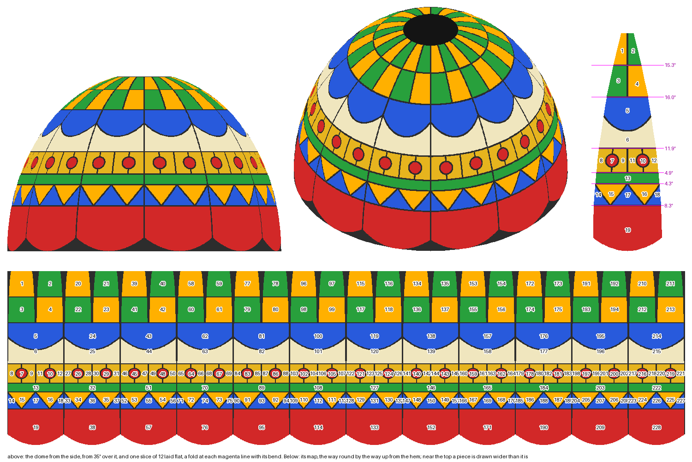

# The piece map

A stained-glass panel as closed pieces of glass, each with its colour, and the lead lines between them (M20 in mqucifer/project-print `ROADMAP.md`, mqucifer/print-shop#152, mqucifer/print-shop#153). It's the handover between what draws a panel's pieces and what fixes and builds them. Two things draw one: a traced picture (`pieces trace`), and rules for a repeated pattern (`pieces dome`, mqucifer/print-shop#154), whose map is a dome's and is cut into flat slices (`pieces flatten`), each a map like any other. Every `pieces` command reads and writes this one format (`bench/piecemap.py`), so both ways in share everything after the pieces are drawn. [The bench](bench.md#a-piece-map-traced-checked-fixed-and-built) says what each command answers.

## The format

JSON, in millimetres, x to the right and y up from the panel's bottom-left:

```json
{
 "piece_map": 1,
 "units": "mm",
 "panel": {"width_mm": 220.0, "height_mm": 160.0},
 "lead_mm": 1.4,
 "colours": {"blue": {"rgb": [40, 110, 220]}},
 "pieces": [
  {"id": 1, "colour": "blue", "outline": [[0, 80], [0, 40.7], [39.3, 40.7], [39.3, 80]]},
  {"id": 2, "colour": "gold", "outline": [[40.7, 80], [40.7, 40.7], [120, 40.7], [120, 80]],
   "holes": [[[60, 55], [70, 55], [70, 65], [60, 65]]]}
 ],
 "flags": [{"flag": "sliver", "piece": 7, "figure": 2.0, "limit": 3.0, "at": [41.7, 60.4]}],
 "source": {"by": "pieces trace", "image": "scene.png", "px_per_mm": 5.0, "glass_share_pct": 91.2},
 "history": [{"fix": "merge", "a": 12, "b": 9}],
 "surface": {"kind": "dome-slice", "slice": 1, "folds": [{"fold": 1, "y_mm": 55.03, "bend_deg": 13.74}]}
}
```

| Key | It holds | Read by |
|---|---|---|
| `piece_map` | the format's version, 1 | every command: anything else isn't a piece map |
| `panel` | the panel's size, a rectangle from (0, 0), or with `outline` any closed shape | every command: the lead is the panel less every piece |
| `lead_mm` | the lead line's usual width | `split` and `extend`, which draw a new line at it; `check`, whose dead ends and wide lead are sized by it; `build`, whose border is twice it unless given |
| `colours` | each colour's name and its `rgb` | `build`, which writes one pane file a colour; the pictures |
| `pieces` | each piece: `id`, a whole number from 1; `colour`; `outline`, three points or more; `holes`, where another piece or a line lies inside it; and from a trace `paint`, the picture's colour over it and how far it runs across | every command |
| `thickness_mm` (a piece's) | its pane's own thickness, where it isn't the frame's usual | `build` refuses a map that names several: panes of several thicknesses in one frame aren't built yet |
| `flags` | the rule breaks as `trace` or a fix last read them | a reader only: `check` reads the pieces again, and no command trusts these |
| `source` | what drew the map, and its glass share then | `check` and each fix, which say the share now against it |
| `history` | each fix made, in order | a reader only |
| `surface` | what the map lies on, where that isn't a flat panel: a dome's chart, or one flat slice of a dome with its folds and edges ([below](#a-dome-from-rules-and-its-flat-slices)). A flat panel's map has none | `flatten`, which cuts a dome's chart; the joining stage, which reads a slice's; every fix keeps it |

**A piece is its glass.** Its outline is where the glass meets the lead, so the lead is the panel less every piece and no line is stored twice. Two pieces never overlap, and every piece lies inside the panel: a map that breaks either is refused, saying which pieces. A map from rules writes each cell inset by half its lead.

**A map is written to a tenth of a micron,** and read back before it's saved, so no command writes a map the next can't read. A fix writes a new file and leaves the one it was given: `scene.pieces.json`, then `scene.pieces-1.json`, `-2` and so on, or `--to FILE`.

## A file of fixes

`pieces fix MAP STEPS` makes a list of fixes in one call (mqucifer/print-shop#161). STEPS is JSON: a list of steps, or `{"steps": [...]}`, each a fix's name and what its own command takes:

```json
[
 {"fix": "merge", "a": 12, "b": 9},
 {"fix": "split", "piece": 4, "line": [[40, 15.3], [80, 15.3]], "lead_mm": 1.4},
 {"fix": "extend", "at": [20, 55], "aim": [20, 80]},
 {"fix": "drop-line", "at": [41.5, 60]}
]
```

| Step | It needs | It may have |
|---|---|---|
| `merge` | `a`, the piece that joins, and `b`, the neighbour it joins | |
| `split` | `piece`, and `line`, two points or more from one of its edges to another | `lead_mm`, the new line's width: the map's unless given |
| `extend` | `at`, a point on the dead end | `aim`, a point to run it toward |
| `drop-line` | `at`, a point on the line | |

- **The steps run in order,** each on the map the one before left, and a piece's number is what it is by then: a merge keeps B's, and a split's new pieces take the next numbers.
- **A map's `history` is a steps file.** Each fix is written there as a step is given (an extension's `from` and `to` are read as `at` and `aim`), so the fixes a map has had can be made again on the map they began from, and give the same pieces.
- **It stops at the first step that's refused,** and writes the map up to it. Every step is read before any is made, so a file with a step that can't be read changes nothing.

## What a map from rules needs

`piece_map`, `panel`, `lead_mm`, and `pieces` with `id`, `colour` and `outline`. `colours` gives the pictures their colours, and `source.glass_share_pct` gives later readings something to be said against. Curves are points close enough that the lines and arcs `build` fits to them, within `--fit` of each point, are the curve meant: `tests/bench_cases/planted_pieces.py` writes such a map (`rules.json`), and `pieces dome` writes a dome's.

## A dome from rules, and its flat slices

(mqucifer/print-shop#154, M20's lamp.) A shade is a dome of stained glass: one motif repeated round it, in bands from its top to its hem. Its pieces follow the dome's own lines, down and around, so they're made from a few figures, in code (decided at M20's planning session, 2026-11-17). A real dome is made of flat pieces, and its curve comes from slight angles along the lead lines. So the dome's map is cut along lead lines into slices, each laid flat as its own map, and those are what `check` reads and `build` builds. Bending and joining them is the lamp's next stage.

### The bands file

`pieces dome --diameter D --height H --repeats N --bands FILE` reads the bands from the top to the hem:

```json
{
 "lead_mm": 1.4,
 "colours": {"moss": {"rgb": [90, 120, 60]}},
 "bands": [
  {"pattern": "grid", "height_mm": 48, "rows": 2, "columns": 2, "colours": ["amber", "moss"]},
  {"pattern": "swag", "height_mm": 38, "depth_mm": 12, "colours": ["blue", "cream"]},
  {"pattern": "jewels", "height_mm": 18, "diameter_mm": 8, "count": 2, "colours": ["red", "gold"]},
  {"pattern": "strip", "height_mm": 8, "colours": ["green"]},
  {"pattern": "triangles", "height_mm": 16, "count": 2, "colours": ["amber", "blue"]},
  {"pattern": "scallop", "depth_mm": 10, "colours": ["red"]}
 ]
}
```

- **`height_mm`** is the band's height down the dome, along it. The heights add up to the dome's side, from its opening's edge to its hem, which the reply gives (`meridian_mm`: 161.18 mm for a dome 200 across and 130 tall). One band may leave its height out, and takes what the others leave. Heights that don't add up are refused, saying both figures.
- **`lead_mm`** is each lead line's width, 1.4 unless given. **`colours`** gives the rgb of any colour the bench has no name for.
- **Each pattern** is laid once in a repeat, and its figures are its own. A figure is to the middle of a lead line, but a jewel's diameter, which is its glass:

| Pattern | Its cells in one repeat | Its figures | Its `colours`, in order |
|---|---|---|---|
| `grid` | `rows` by `columns` cells, between lines down and round the dome | `rows`, `columns`, each 1 unless given | cell (row, column) takes colour row + column, counted round the list, so two colours make a chequer |
| `swag` | a drape hung between the repeat's two sides, and the ground under it | `depth_mm`, how far its middle hangs under its ends; `shoulder_mm`, how far its ends are under the band's top: half of what the depth leaves unless given | the drape, then the ground |
| `jewels` | `count` round jewels on the band's middle, each with a line up and a line down from it, so the ground beside it is two pieces and no piece surrounds another | `diameter_mm`, the jewel's glass; `count`, 1 unless given | the jewel, then the ground |
| `strip` | `count` pieces side by side | `count`, 1 unless given | each piece in turn |
| `triangles` | `count` triangles point down from the band's top, `count` − 1 point up between them, and half of one at each side | `count`, 1 unless given | those that point down, then those that point up |
| `scallop` | `count` cells whose bottom edge is the dome's hem, each curving `depth_mm` down from its sides to its middle. The last band only | `depth_mm`; `count`, 1 unless given | each cell in turn |

- **Lines meet as lines, by construction.** Each band's top and bottom are lines all the way round, each repeat's sides are lines from the top to the hem, and every other line runs from one of those to another. So no line ends in glass, no piece is inside another, the dome can be cut at any repeat's side, and it bends at any band's edge.
- **What isn't refused is still checked.** A cell its lead leaves no glass in is refused, saying which band. A cell that's a sliver, or a ground with a thin neck beside a jewel, is made, and `pieces check` on the slice flags it.

### The dome's map

- **The surface** is half an ellipsoid, open at its top: its side is a quarter of an ellipse, half `--diameter` out and `--height` up, turned round the dome's axis. It's a hemisphere where the height is half the diameter. `--top` is the opening at its top, across, a fifth of the diameter unless given: it's for the lamp's fitting, and slices that met at a point would have no width there. At 200 by 130 with 12 repeats, a slice is about 161 mm from top to hem and 52 mm across at the hem, as M20 planned.
- **The map is the dome's chart.** x is the way round, in mm as it is at the hem, from 0 to the hem's whole length; y is up the dome from the hem, along it. It's true to size up and down, and round the hem. Nearer the top everything is drawn wider than it is, by the hem's radius over the dome's there.
- **A piece is its cell less half the lead along each line, on the dome itself:** a distance round is the angle times the dome's radius at that point, so the lead is as wide near the top as at the hem, and wider on the chart near the top. The dome's top and hem are the glass's own edges, as a panel's edge is.
- **The picture** comes with the map, as a trace's does, since a shade is judged by eye: the dome in its colours from the side and from 35° over it, one slice of its repeats laid flat with its pieces numbered and each fold's bend, and the chart. This is the six-band dome above:



- **`surface`** says so: `kind` `dome`, `profile`, `diameter_mm`, `height_mm`, `top_mm`, `meridian_mm`, `repeats`, each band's figures and where it lies, and the glass share on the dome.
- **`check`, the fixes and `build` read a flat panel,** so on this map their widths and areas aren't the glass's, and `check` says so. Cut it first.

### A slice's map

`pieces flatten MAP --slices N` writes `MAP's name.slice-01.pieces.json` and so on, one for each slice. N is the map's repeats unless given, and the cuts are evenly round from the map's x = 0. A cut that crosses a piece is refused, naming the pieces: 12 repeats cut into 12, 6, 4 or 3.

- **A slice is a stack of flat rows.** A fold is a lead line that runs all the way round: each height no piece of the map reaches across, read from the map as it is now. Between two folds a slice is one flat row, its four corners on the dome where its folds meet its cuts.
- **How many rows.** A slice folds at every lead line that runs all the way round, so its rows are those lines and one: 7 for the six-band dome. That's the most a map allows, and the nearest its slices come to the curve. `--rows R` asks for fewer: it then folds at the R − 1 lines that leave its rows nearest the dome, every way of choosing them tried, and is flat across the rest. The reply says the rows it used of those the map allows, how far they stand from the dome, and for every count what that distance and the sharpest bend would be (`rows_choice`), so rows are traded against bends by eye: on the six-band dome 7 rows stand 4.17 mm off with folds up to 16.0°, 4 rows 4.46 mm with folds up to 23.6°, and 2 rows 10.02 mm with one fold of 35.2°. More rows than the map has lines for come from the bands file: another band, or another row of a grid.
- **A place on the dome goes to the row's place** as far between its folds, by the way down the dome, and as far between its cuts, by the angle round. A line down the dome stays straight, and a line round it becomes a straight line across, so a slice bends along straight lines. A flat row is a little shorter and narrower than the dome it stands for, and away from a slice's middle its lines down the dome lean toward the top, so a shape is a little off true there. On the six-band test dome the lead between two neighbours reads 1.34 to 1.40 mm flat where the dome's is 1.4, and a round jewel of 8 mm, a quarter of the way across its slice, is 7.70 by 8.13 mm (`~/print-shop/proofs/m20-dome/six/`).
- **It's drawn as seen from outside the dome,** its hem at the bottom, in mm from its outline's bottom-left.
- **Its panel's edge is the glass's edge,** half a lead inside each cut's middle. So `pieces build MAP --border 0.7`, half the lead, puts the frame's edge on the cut's middle, and two slices meet in one line as wide as the lead. A wider border overlaps its neighbour's.
- **`surface`** holds what the joining stage reads, each y in the map's own mm:

| Key | It holds |
|---|---|
| `kind`, `of`, `dome` | `dome-slice`, the dome's map it was cut from, and that dome's size |
| `slice`, `slices`, `turn_deg` | which slice of how many, and its middle's angle round the dome |
| `hem` | where the slice's middle meets the hem: `at`, on the map; `out_mm`, how far that is from the dome's axis; `z_mm`, its height; `tilt_deg`, the lowest row's tilt from level |
| `rows` | each row from the hem up: `y_mm`, its bottom and top; `tilt_deg`; `join_deg`, the angle between it and its neighbour's row across a cut |
| `folds` | each fold from the hem up: `y_mm`, and `bend_deg`, the angle the line bends through, toward the dome's axis |
| `edges` | `left` and `right`: `slice`, the neighbour it's shared with; `half_line_mm`, from the panel's edge to the cut's middle; `flat`, the cut's middle on the map, a point at the hem, each fold and the top; `on_dome`, those points in space, x, y, z from the dome's axis at the hem's height; `join_deg`, each row's |
| `dome_pieces` | each piece's number on the dome's map, in the slice's own order |

- **Bent back, a slice gives the dome back.** From the hem's place and tilt, each row runs on by its length and turns by its fold's bend; the slice is then turned `turn_deg` round the axis. `flatten` does this from each file it wrote, and holds it to the dome: each corner within `--tolerance`, 0.01 mm, of its place by the ellipse and the angle round, each piece's points as near the flat through their row's corners, and each edge as near its neighbour's. Further apart is `DISAGREE`.
- **How far the flat rows stand from the curved dome** between their corners is a reading (`rows_off_dome_mm`), at least the chord across a slice at the hem: 3.4 mm for 12 slices of a 200 mm dome, and 4.2 with a row 33 mm tall there. It's a limit only where `--max-off` gives one. More slices, or more lines round the dome, bring it nearer.
- **Slices that are the same** are said (`alike`), and written point for point the same, so one check and one build stand for each group.
- **`--bed X,Y`** is the bed each has to fit, 256 by 256 unless given: `FAIL` where one doesn't.
- **A fix on a slice keeps its `surface`.** One that joins two pieces across a fold leaves glass where the slice bends: a slice bends only along lead, so don't.
